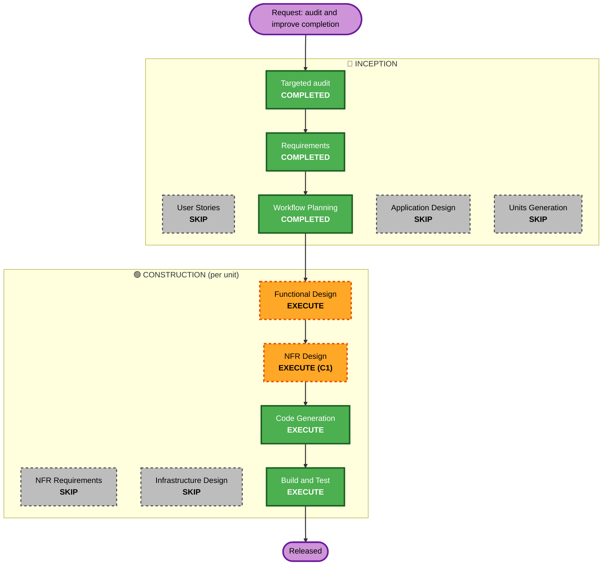

# Execution plan: profile completion (2026-10-21)

Inputs: `../requirements/completion-requirements.md` (approved 2026-10-21), `../review/profile-completion-audit.md`.
Part of the onboarding-tour cycle (user, 2026-10-21: "keep this in the cycle").

## Analysis summary

- **Transformation:** a domain rewrite inside an existing module (the worker area's completion) plus screen changes;
  no new service, no infrastructure.
- **User-facing:** yes, at C2 only (the ticks, the badge, the checklist, the apply button, the service step).
- **Data model:** no new column. The **meaning** of the stored `setupProgress` / `profileCompleted` changes (FR-STO-01),
  applied by a backfill at C2's release.
- **API:** additive (`GET /v1/worker/completion`); the profile read unchanged (NFR-C1).
- **NFR:** a scheduled job (bounded, leased, idempotent).

**Found while planning (for OC-1):** the api's scheduler (`platform/jobs/scheduler.ts`: one lease per job, a
watermark) already runs `onboarding-reconciler` every 5 minutes over the rows changed since its watermark, **including
`verification_requirements.reviewedAt`**, which the admin's approve / reject / reset set. A completion job of the same
shape covers FR-STO-02 (within minutes) and FR-STO-03 (catalogue changes, writes outside the api) **without changing the
Next.js admin routes**. Functional Design confirms.

**Risk:** Medium. Rollback: the api's previous image (the new entry and job go; the stored flags stay as last written);
the app by Vercel promote; the backfill has a dry run and a report, and the old meaning can be restored by re-running
the previous image's backfill.

## Workflow

| Stage | Decision | Rationale |
|---|---|---|
| User Stories | SKIP | one persona (the worker) plus the admin's view; the FR tables carry the acceptance |
| Application Design | SKIP | inside the worker module and its screens; the pieces are designed per unit |
| Units Generation | SKIP | the two units are fixed (requirements §5) |
| Functional Design | EXECUTE, C1 and C2 | C1: the declaration of items, each rule, the entry's shape, the stored-flag mapping, the job (OC-1), the service table's exposure (OC-2), the oracle comparison. C2: the screens, the admin preview (OC-3), the pop-up (OC-4) |
| NFR Requirements | SKIP | NFR-C1..C5 set them |
| NFR Design | EXECUTE, C1 only | the job's batching, lease, timeout and watermark; the backfill's safety; the rollback of a meaning change |
| Infrastructure Design | SKIP | no new resource; the scheduler and Cloud Run as they are |
| Code Generation, Build and Test | EXECUTE, per unit | always |

## Units and order

| Unit | Branch | Packages | Ships |
|---|---|---|---|
| **C1 `completion-api`** | `feat/completion-api` from `main` | `apps/api` (domain, the entry's handler, the job, the backfill script), `packages/api-contract` (the entry, `openapi.json`), `docs/worker/README.md` §4 | PR → `main` → staging → **promotion**; invisible to every screen until C2 (the job writes the **old** meaning until C2's switch, see below) |
| **C2 `completion-app`** | `feat/completion-app` from `main` **after `feat/account-app` is released** | `apps/app` | its own release; in the same window the backfill and the switch of the stored flags' meaning |

**The meaning switch (NFR-C1).** C1 ships the new definition behind the new entry and keeps the stored flags on the
old meaning; one setting (a config value per stage) flips the job, the writes and the backfill to the new meaning at
C2's release. Functional Design C1 confirms or replaces this.

**Sequence:** C1 Functional Design → C1 NFR Design → C1 code → PR, CI, merge, staging checks → promotion (on the user's
word) → [`feat/account-app` released] → C2 Functional Design → C2 code → preview → the release window: flip the
setting on prod, the backfill (dry run, report, apply), merge C2 → production checks.

## Success criteria

- One declaration; no completion rule in `apps/app` (a grep in the C2 PR finds none).
- The three screens agree for every worker (a property over generated profiles: the ticks' count = the percent's
  numerator; the checklist's My Profile item = percent 100).
- Stored flags = computed flags for every worker within one job period, after an admin's document action included.
- Gates green; baselines unchanged; the staging and preview checklists recorded.
