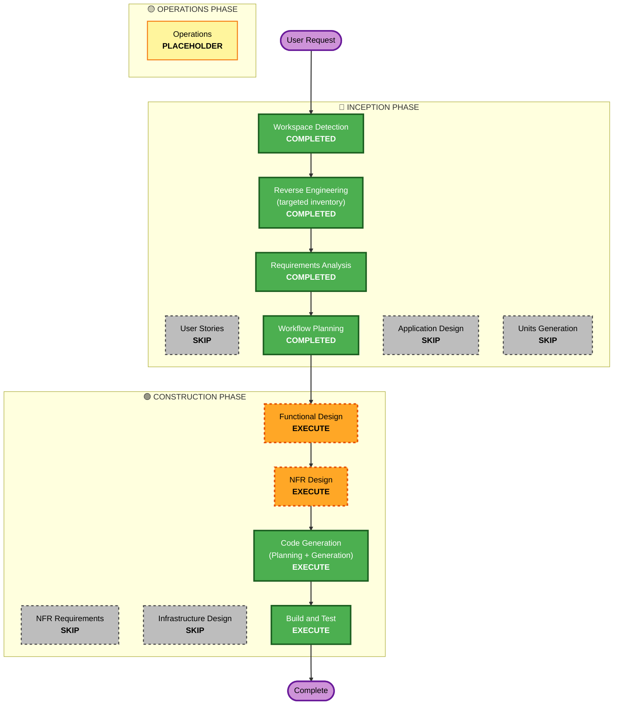

# Execution Plan: onboarding-tour (2026-10-21)

Inputs: `../requirements/requirements.md` (approved 2026-10-21), `../inventory/onboarding-tour-inventory.md`.

## Detailed Analysis Summary

### Transformation Scope
- **Transformation type:** single feature across two layers; no architectural change.
- **Primary changes:** a tour component and its step declaration in `apps/app` (on `feat/account-app`); one "seen"
  timestamp with its own read and save in `apps/api`.
- **Related components:** `packages/db` (one migration), `packages/api-contract` (two entries), `apps/api` (two
  handlers), `apps/app` (Sidebar anchors, DashboardLayout drawer control, SimpleDashboardHeader help button, the home
  page), `docs/worker/README.md`, `openapi.json`.

### Resolved during planning: OI-1 (where "seen" travels)
`profileSchema` (`packages/api-contract/src/worker.contract.ts`) is a `z.strictObject`, and `createClient` throws when
a response does not match its schema. A new field in `GET /v1/worker/profile` would therefore break today's production
app as soon as the api is promoted (NFR-02). **Decision: the profile read is not changed.** "Seen" gets its own entries
in the worker contract (a read and a save, e.g. `GET` / `PUT /v1/worker/tour`), called only on the dashboard home
(NFR-07: no extra request elsewhere). Old apps never call them, so the promotion is invisible to production.

### Change Impact Assessment
- **User-facing:** yes, the welcome card, the five steps, the help button (workers only).
- **Structural:** no; the tour is a client component; the api gains two entries in an existing area.
- **Data model:** yes, one nullable timestamp (expand-only migration; `worker_profiles` vs `users` at Functional Design, OI-2).
- **API:** yes, additive (two new entries); no existing response changes.
- **NFR:** small; access, rate limit, idempotency, "never in the way" (NFR-01).

### Component Relationships
- **Primary:** `apps/app` (the tour).
- **Shared:** `packages/api-contract` (the entries, used by both apps); `packages/db` (the column).
- **Dependent:** `apps/api` binds the entries (it refuses to boot if one is unbound).
- **Supporting:** `deploy-api` (staging on merge, promotion by dispatch); Vercel previews; no infra change.

### Risk Assessment
- **Risk level:** Low. Additive api, expand-only migration, a client-only UI that fails silent.
- **Rollback:** easy. Api: previous image (`b8fe2eb`). App: Vercel promote.
- **Testing:** moderate: the tour's UI flow (desktop and phone widths) is checked on the preview by hand; its logic by
  unit and property tests.

## Workflow Visualization

## Phases to Execute

### 🔵 INCEPTION PHASE
- [x] Workspace Detection (COMPLETED)
- [x] Reverse Engineering (COMPLETED: targeted inventory)
- [x] Requirements Analysis (COMPLETED, approved 2026-10-21)
- [x] User Stories (SKIPPED): one persona (the worker), one flow; the requirements' FR tables and the verification
  protocol already state the acceptance criteria
- [x] Execution Plan (this document)
- [ ] Application Design - **SKIP**
  - **Rationale:** no new service or module; the api entries follow the worker area's existing pattern (contract entry
    + handler), and the app's pieces (step declaration, tour component, anchors) are designed per unit in Functional
    Design
- [ ] Units Generation - **SKIP**
  - **Rationale:** the two units are fixed here (below)

### 🟢 CONSTRUCTION PHASE
- [ ] Functional Design - **EXECUTE** (one document per unit, concise)
  - **Rationale:** U1: the column's table and name (OI-2), the entries' paths, shapes, limit and audit name (OI-3).
    U2: the tour's state machine, the step declaration and its targets (OI-4), the drawer control (OI-5), the
    workers-only help button (OI-6), the five step texts for the user's review (OI-7, D10)
- [ ] NFR Requirements - **SKIP**
  - **Rationale:** NFR-01..10 in `requirements.md` already set them; the resiliency targets are carried forward (F2 A)
- [ ] NFR Design - **EXECUTE** (one short document for both units)
  - **Rationale:** RESILIENCY-14 (the failure scenarios: the save failing, the read failing, the api down while the
    home loads) and PBT-01 (the properties to write) were deferred to this stage
- [ ] Infrastructure Design - **SKIP**
  - **Rationale:** no infrastructure change: one migration through the existing deploy, no new secret, service,
    bucket or alert
- [ ] Code Generation - EXECUTE (ALWAYS), per unit
- [ ] Build and Test - EXECUTE (ALWAYS), per unit

### 🟡 OPERATIONS PHASE
- [ ] Operations - PLACEHOLDER

## Units and Package Change Sequence

| Unit | Branch | Packages | Ships |
|---|---|---|---|
| **U1 `tour-seen-api`** | `feat/tour-seen-api` from `main` | `packages/db` (migration) → `packages/api-contract` (two entries, `openapi.json`) → `apps/api` (handlers, tests incl. the PostGIS test) → `docs/worker/README.md` | PR → `main` → staging; promoted to prod before the app release |
| **U2 `tour-app`** | `feat/onboarding-tour` from `feat/account-app`, with `feat/tour-seen-api` merged in | `apps/app` only | merged into `feat/account-app`; released with it (D12) |

**Order (sequential; U2 needs U1's contract):**
1. U1 Functional Design → NFR Design (both units) → U2 Functional Design (with the step texts for your review).
2. U1 Code Generation → gates → PR → CI (API Quality's database tests) → merge → staging checks (requirements §6.2,
   including today's production app build against staging). Merge `main` into `feat/account-app` too.
3. U2 Code Generation on `feat/onboarding-tour` → app gate → push → the `feat/account-app` preview against staging.
4. **Release, only on your word:** promote the api (deploy-api, stage=prod, the full sha of U1's merge) → production
   api checks → the `feat/account-app` release (its own preview checklist plus the tour's, §6.4) → production checks →
   rollback rows re-recorded.

**Rollback:** U1 — the previous image `b8fe2eb...` (the column stays, unused). U2 — Vercel promote of the deployment
before the release (it also rolls back `feat/account-app`, since they ship together).

## Estimated Timeline
- **Stages to run:** Functional Design (×2), NFR Design, Code Generation (×2), Build and Test (×2).
- **Estimate:** one to two working sessions to build both units; the release then waits for `feat/account-app`'s
  preview checklist.

## Success Criteria
- **Primary goal:** a worker's first visit to the dashboard home offers a five-step tour of how to complete the
  profile, shown once per worker on any device, replayable from the header.
- **Key deliverables:** the migration and two api entries (U1); the tour component, the step declaration, the sidebar
  and checklist anchors, the drawer control, the help button (U2); the docs.
- **Quality gates:** every package's `quality` green with baselines unchanged; `turbo run build`; CI incl. API
  Quality's PostGIS tests; the property tests (NFR Design's list).
- **Integration:** the preview checks of requirements §6.4 on desktop and phone widths; the production app unchanged
  by U1's promotion (§6.2).
- **Operational readiness:** the existing api policies cover the new entries; no new alert (SECURITY-14 N/A).
