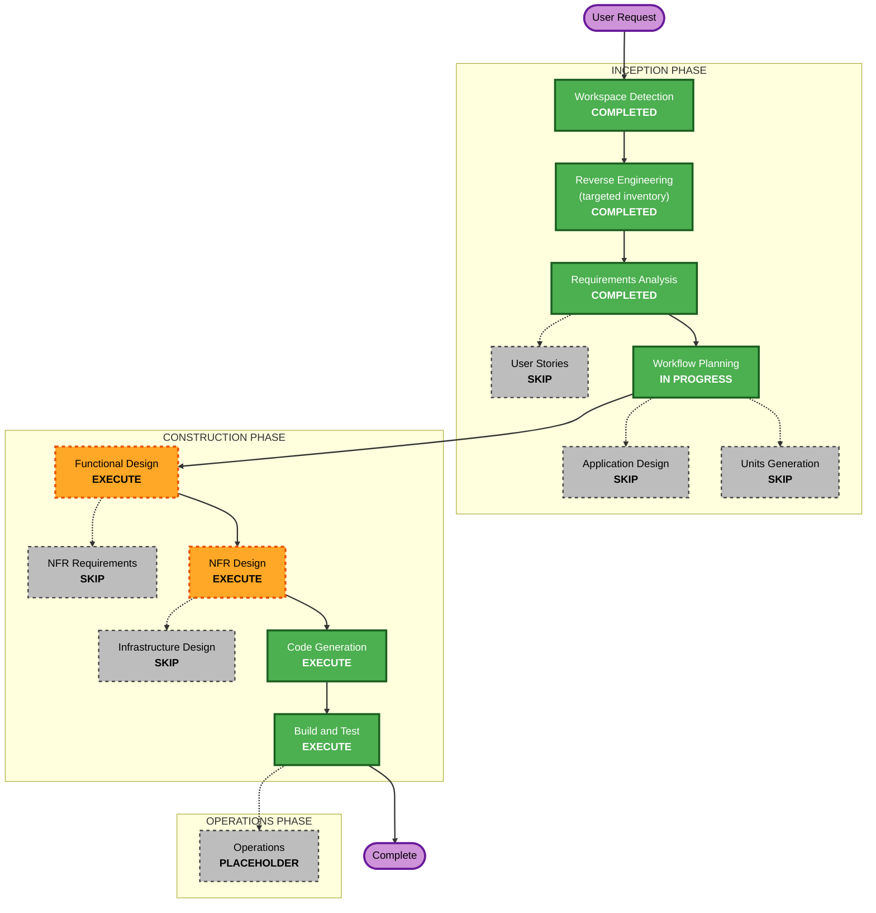

# worker-activation: execution plan (2026-10-23)

Inputs: `../requirements/requirements.md` (approved 2026-10-23; its "Today" section is the targeted inventory).

## Detailed analysis summary

### Transformation scope
- **Type:** one feature across existing components; no new service, no infrastructure change.
- **Primary changes:** one column on `worker_profiles`; two admin writes (activation, suspension) and a status filter
  on the api; the card switch, the filter, the worker's admin page, the client search, the public list and the
  worker's dashboard note in the app.

### Change impact
- **User-facing:** yes. Admins: the switch's meaning, a Status filter, Suspend/Restore on the worker's page, "Suspended
  accounts". Clients and the public: only activated workers (empty at release, R-1). Workers: a dashboard note.
- **Structural:** no. Same components and boundaries (P-1..P-7 unchanged).
- **Data model:** yes, expand-only: a boolean column on `worker_profiles`, `NOT NULL DEFAULT false`, with an index for
  the client/public lists. **The reset (FR-3) is the column's default**: adding it sets every existing row inactive,
  so no update statement and no backfill; every new profile gets the default (FR-2).
- **API:** additive. New entries: set activation, suspend/restore (moving the Next route
  `PATCH /api/admin/contractors/[id]/status` onto `apps/api`, "Dynamic by default"). `GET /v1/admin/workers`: a new
  status filter and a **new** response field for the flag. The existing `isActive` (= not suspended) keeps its meaning
  until U2 has shipped, so the app on production between the api promotion and the app merge still shows and writes
  what it does today. The worker's profile read gains the flag for the dashboard note.
- **NFR:** small. Security: two admin writes on the existing pipeline. Performance: one indexed boolean in three lists.

### Component relationships

| Component | Change | Priority |
|---|---|---|
| `packages/db` | migration + Prisma field (+ index) | critical (U1) |
| `packages/api-contract` | the two admin writes, the filter, the new field, the profile read field; `openapi.json` | critical (U1) |
| `apps/api` | handlers, the filter row, search/list mapping, the profile read | critical (U1) |
| `apps/app` | card switch, Status filter, Suspend/Restore, "Suspended accounts", client search, public list, dashboard note; remove the old status route | important (U2) |
| `apps/web` | none (it fetches the app's `/api/public/workers`) | -- |
| `docs/admin`, `docs/worker` | the entries | important |

### Risk
- **Risk level:** Medium. The code is small and additive, but the release hides every worker from clients and the
  public (R-1, accepted) and moves suspension off the card (R-2).
- **The release moment is the U2 merge**, not the migration: until the app reads the flag, nothing user-facing
  changes. So U2 merges when admins are ready to start activating.
- **Rollback:** U2 by Vercel promote (the lists show everyone again at once); U1 by the previous api image
  (`bf9b966...` today); the column stays.
- **Testing:** database-gated tests (the writes, the filter, the default on new and existing rows) run in CI (this
  machine's Docker is down).

## Workflow visualization

## Phases

### INCEPTION
- [x] Workspace Detection (COMPLETED)
- [x] Reverse Engineering (COMPLETED: the targeted inventory in `requirements.md`)
- [x] Requirements Analysis (COMPLETED, approved 2026-10-23)
- [x] User Stories (SKIPPED: admins act, workers/clients see; acceptance is in FR-1..FR-11)
- [x] Workflow Planning (this document)
- [ ] Application Design -- **SKIP**: no new component; every change follows an existing pattern (contract entry +
  handler; the admin filter registry; the admin page; the dashboard home).
- [ ] Units Generation -- **SKIP**: the two units are fixed here (below).

### CONSTRUCTION (per unit)
- [ ] Functional Design -- **EXECUTE** (U1 and U2): the column's name and default, the two writes' rules and errors
  (unknown worker, a non-worker account, idempotent repeats), the filter values, the transition field, the card's
  states, the Suspend/Restore placement and confirmation, the note's wording and place.
- [ ] NFR Requirements -- **SKIP**: NFR-1..NFR-5 are in the requirements; no new stack.
- [ ] NFR Design -- **EXECUTE**, one short shared document: the security and resiliency baselines applied (blocking),
  the PBT properties per unit, the index and the lists' query plans, the cache/ETag behaviour after a switch.
- [ ] Infrastructure Design -- **SKIP**: no Cloud Run, secret, alert or Vercel change; the migration ships as the
  others do (CI applies it; staging, then production by promotion).
- [ ] Code Generation -- EXECUTE (always)
- [ ] Build and Test -- EXECUTE (always): the gates, the database-gated tests in CI, the preview checklist.

### OPERATIONS
- [ ] Operations -- placeholder (the promotion and production checks are recorded in Build and Test).

## Units and sequence

| Unit | Branch | Content | Ships |
|---|---|---|---|
| **U1 `activation-api`** | `feat/worker-activation-api` | migration + Prisma field; contract: set activation, suspend/restore, the admin Status filter, the new flag field on the admin search, the flag on the worker's profile read; handlers; tests incl. PBT; docs | merge → staging → the preview checklist + activation checks → promote by full sha. **No user-facing change.** |
| **U2 `activation-app`** | `feat/worker-activation-app` | card switch on the new entry; Status filter; Suspend/Restore on the worker's admin page; "Suspended accounts"; the client search and public list read the flag; the dashboard note; remove `PATCH /api/admin/contractors/[id]/status`; tests; docs | after U1 is on production (checked by refs and by the prod route answering): PR preview (against staging) → merge **when admins are ready to activate** → production checks |

- **Critical path:** `packages/db` → `packages/api-contract` → `apps/api` (U1) → `apps/app` (U2).
- **Merge-order guard (follow-up 32):** U2's PR description names the U1 sha that must already be on prod; I check the
  prod route before saying it can merge.

## Estimate
FD and Code Generation per unit, one NFR Design, Build and Test; 2 PRs of code plus the record.
