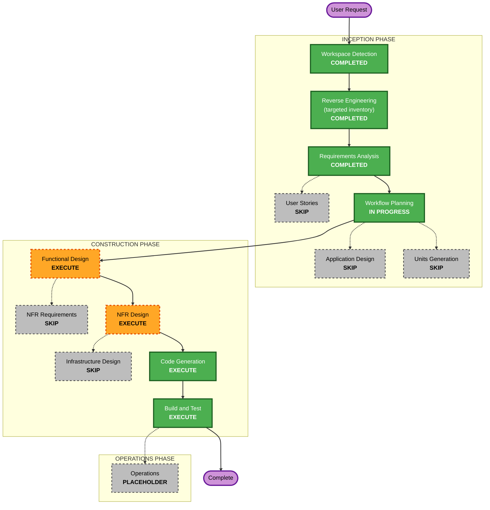

# worker-tools: execution plan (2026-10-22)

Inputs: `../inventory/worker-tools-inventory.md`, `../requirements/requirements.md` (approved 2026-10-22, FR-10's
note in the proposed wording: "Some jobs require your own tools, so please be ready to bring them.").

## Detailed analysis summary

### Transformation scope
- **Type:** single feature across existing components; no new service, no infrastructure change.
- **Primary changes:** two tool lists (shared data), two columns on `worker_services`, one worker write, the profile
  read and the admin search widened, the Services step, the admin search and page, a sign-up note.

### Change impact
- **User-facing:** yes. Workers: a checklist on two Services steps; a note at sign-up. Admins: a filter and a section.
- **Structural:** no. Same components and boundaries (P-1..P-7 unchanged).
- **Data model:** yes, expand-only: `worker_services."toolIds" text[] NOT NULL DEFAULT '{}'`, `"otherTools" text[] NOT
  NULL DEFAULT '{}'`, a GIN index on `toolIds`. No backfill (empty is correct).
- **API:** yes, additive: `PUT /v1/worker/services/:categoryId/tools`; `tools` on each service of the profile read;
  `tools` on `GET /v1/admin/workers`; the admin page's read. Old clients ignore the new fields.
- **NFR:** small. Security: a new write on the existing pipeline. Performance: one array containment in the search.

### Component relationships

| Component | Change | Priority |
|---|---|---|
| `packages/schemas` (`data/serviceTools.ts`) | new: the lists, ids, labels, the Other normalisation | critical (both units read it) |
| `packages/db` | migration + Prisma fields | critical (U1) |
| `packages/api-contract` | worker + admin entries, `openapi.json` | critical (U1) |
| `apps/api` | handler, profile read, admin filter, admin detail read | critical (U1) |
| `apps/app` | Services step checklist, admin filter + page, sign-up note | important (U2) |
| `docs/worker`, `docs/admin` | the entries | important |

### Risk
- **Risk level:** Low. Additive, expand-only, one write on proven patterns.
- **Rollback:** easy. App: Vercel promote. Api: the previous image; the columns stay (empty defaults are valid).
- **Testing:** moderate: database-gated tests for the write and the filter run in CI (this machine's Docker is down).

## Workflow visualization

## Phases

### INCEPTION
- [x] Workspace Detection (COMPLETED)
- [x] Reverse Engineering (COMPLETED: the targeted inventory)
- [x] Requirements Analysis (COMPLETED, approved 2026-10-22)
- [x] User Stories (SKIPPED: one actor per side, acceptance is in FR-1..FR-10)
- [x] Workflow Planning (this document)
- [ ] Application Design -- **SKIP**: no new component; every change sits inside an existing one and follows its
  pattern (contract entry + handler; the admin filter registry; the Services step; a form-definition note).
- [ ] Units Generation -- **SKIP**: the two units are fixed here (below).

### CONSTRUCTION (per unit)
- [ ] Functional Design -- **EXECUTE** (U1 and U2): the list declaration and ids, the Other normalisation, the write's
  rules and errors, the all-of filter, what the step and the admin views show.
- [ ] NFR Requirements -- **SKIP**: NFR-1..NFR-5 are in the requirements; no new stack.
- [ ] NFR Design -- **EXECUTE**, one short shared document: the security and resiliency baselines applied (blocking),
  the PBT properties per unit, the index and the query plan of the filter.
- [ ] Infrastructure Design -- **SKIP**: no Cloud Run, secret, alert or Vercel change; the migration ships as the
  others do (CI applies it; staging then production by promotion).
- [ ] Code Generation -- EXECUTE (always)
- [ ] Build and Test -- EXECUTE (always): the gates, the database-gated tests in CI, the preview checklist.

### OPERATIONS
- [ ] Operations -- placeholder (the promotion and production checks are recorded in Build and Test).

## Units and sequence

| Unit | Branch | Content | Ships |
|---|---|---|---|
| **U1 `tools-api`** | `feat/worker-tools-api` | `packages/schemas` lists; migration; contract entries (`putServiceTools`, `tools` on the read, `tools` on admin workers, the admin detail); handlers; tests incl. PBT; docs | merge → staging → the preview checklist + tool checks → promote by full sha |
| **U2 `tools-app`** | `feat/worker-tools-app` | the "Your tools" checklist on the two Services steps; the admin filter and the admin page section; the sign-up note; tests; docs | after U1 is on production: PR preview (against staging) → merge → production checks |

- **Critical path:** `packages/schemas` → `packages/db` → `packages/api-contract` → `apps/api` (U1) → `apps/app` (U2).
- **Rollback:** U2 by Vercel promote; U1 by the previous image (`9fdcf6d...` today); the columns stay.
- **Admin page note:** the worker's admin page reads `/api/admin/contractors/[id]` in the app (follow-up 21). U1's
  Functional Design decides whether the tools come from that route (Prisma in the app) or a new admin api read;
  the api read is the default under "Dynamic by default".

## Estimate
6 stages to run (FD, NFR Design, Code Generation and Build and Test per unit); about 2 PRs of code plus the record.
